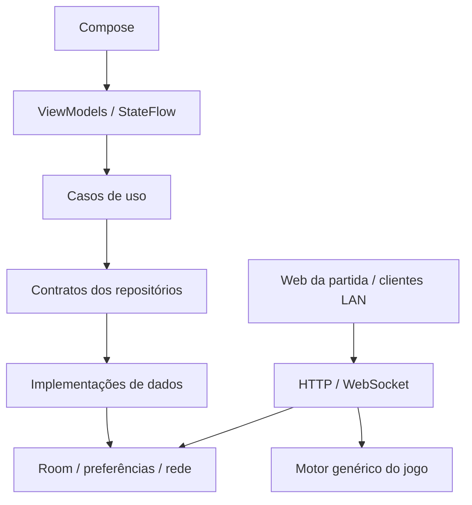

# Arquitetura Kotlin / MVVM — 0.8

## Organização

Todo o código de produção escrito pelo projeto está em Kotlin, em `app/src/main/kotlin/com/automaforge/android`. Os testes JVM antigos em Java foram mantidos como regressões dos contratos; não há testes instrumentados.

| Camada | Responsabilidade |
| --- | --- |
| `presentation` | Telas Compose, ViewModels, estados imutáveis/StateFlow e integração de WebView. Não executa SQL nem conhece o formato de persistência das salas. |
| `domain/model` e `domain/repository` | Modelos de apresentação dos dados públicos, contratos dos repositórios, destino da câmera e política de conexão local. |
| `domain/usecase` | Abrir/encerrar sessão, carregar biblioteca de partidas, configurar IA e enviar uma captura. |
| `domain/game` | Contratos específicos de cada manual, fatos, perguntas, reconciliação visual, propostas e simulador sequencial. O estado JSON extensível foi preservado. Não importa Android ou implementações de `data`. |
| `data/local` e `data/game` | Room/DAO, importação dos JSON antigos, persistência e workspace serializado das salas; memória privada separada. |
| `data/ai`, `data/rulebook`, `data/security` | Transporte Responses, PDF/OCR/referências visuais e armazenamento cifrado da chave existente. |
| `data/lan`, `data/repository`, `data/camera` | HTTP/WebSocket e suas rotas, implementações dos contratos e adaptador de hardware Camera2. |
| `di` | Componente Dagger 2, módulos/providers, escopos e fábrica dos ViewModels. |
| `core` | Utilitários de JSON, geometria normalizada e erros compartilhados. |

A interface nativa de entrada, biblioteca de salas, configuração da IA e câmera usa Compose. A interface completa da partida continua sendo a mesma web servida pelo controlador, integrada por `AndroidView(WebView)` no app e acessível pelo navegador LAN. Essa preservação evita criar dois formulários de regras/estado divergentes ou retirar recursos de clientes existentes. Não se afirma que o HTML da partida foi reescrito como componentes Compose.

`MainActivity` e `CameraActivity` são pontos de entrada pequenos. A seleção de modelo e esforço de raciocínio continua por dropdowns nativos e selects web, compartilhando o catálogo e as preferências já existentes. O funcionamento de inferência automática, perguntas respondíveis, correções humanas e aprovação/execução separadas foi mantido nos contratos migrados.

## Dagger e ciclo de vida

`AutomaForgeApplication` cria o `AppComponent` com o contexto da aplicação. Dagger fornece o banco, repositório das salas, preferências, transporte e casos de uso usados pela fábrica dos ViewModels. O banco e os repositórios que precisam compartilhar sessões são singletons do processo. Não há Activity, WebView, CameraDevice, imagem ou chave em SavedStateHandle.

O ViewModel principal mantém a rota no SavedStateHandle. A URL aceita somente a origem HTTP local configurada; navegação externa continua bloqueada. Sair encerra o host, fecha conexões, cancela jobs e limpa a memória privada. O adaptador HTTP rejeita comandos/resultados após ser fechado. Uma nova sessão usa uma nova instância de servidor.

A câmera pertence ao adaptador de plataforma associado à prévia e ao LifecycleOwner; pausa e descarte liberam sessão, dispositivo, leitor, superfícies e thread. O ViewModel recebe uma imagem por vez e descarta capturas extras durante envio lento, sem formar uma fila de imagens privadas. Fotos de cartas não são persistidas no banco.

Salvar IA gera um evento SharedFlow sem replay. Reabrir o diálogo não repete um evento anterior de fechamento. Salvar, recarregar e apagar chave são serializados no ViewModel, e cancelamento não vira sucesso nem erro de negócio.

## Room e partidas existentes

O banco inicial `automaforge.db`, versão 1, contém:

- `games`: código como chave primária, nome, revisão, data de atualização e documento JSON público.
- `legacy_imports`: resultado de importação de cada arquivo, permitindo sinalizar falhas sem destruir o original.

O esquema exportado está em `app/schemas/com.automaforge.android.data.local.AutomaDatabase/1.json`. Não há fallback destrutivo nem permissão para consultas na thread principal. Os repositórios executam I/O fora da UI; o adaptador síncrono exigido pelo protocolo LAN serializa o workspace e delega o acesso SQL a Dispatchers.IO.

Cada jogo tem variáveis diferentes. Por isso o documento público permanece extensível e versionado dentro da linha Room, sem transformar cores, peças, pilhas ou fases de um jogo em colunas fixas universais. IDs, fatos, evidências, correções, perguntas, definições de ações e campos adicionais não reconhecidos pela camada de persistência são preservados.

A importação lê `files/rooms/CODIGO.json`, verifica o código e prepara os defaults de compatibilidade. Cada inclusão e seu registro de importação ocorrem em transação. Uma sala já presente no Room nunca é sobrescrita pelo arquivo antigo. Arquivos inválidos são sinalizados e isolados; os demais continuam disponíveis. Originais, fotos e diretórios de manuais são mantidos.

Depois da importação, as alterações passam a ser gravadas no Room. Os JSON originais são backups da situação anterior, não cópias continuamente atualizadas. Uma reversão para um APK antigo não enxerga automaticamente o progresso posterior gravado no novo banco. Futuras mudanças no esquema Room precisam de uma migração explícita, com o esquema anterior preservado.

## Privacidade e compatibilidade

A chave continua no ApiKeyStore cifrado e nas mesmas preferências/alias. Modelo e raciocínio mantêm os nomes de preferência e a revisão de configuração existentes. Nenhuma chave é retornada no JSON da sala ou no endpoint de configuração.

Cartas privadas ficam exclusivamente na memória do servidor. `private_cards` e contagem transitória não são incluídos no documento persistido no Room; a representação pública fornece apenas a contagem permitida. Encerrar a sessão elimina essa memória. Manuais e fotos públicas continuam nos mesmos caminhos internos, mantendo referências de cache e evidência.

Rotas, código de sala, formato público, versões do estado e proteção contra proposta antiga foram preservados. Propostas genéricas legadas continuam sem possibilidade de aprovação como movimento concreto. Regras/cobertura extraídas pela IA não viram regras humanas verificadas por causa da migração.

## Verificação e limites

Os testes JVM cobrem contratos anteriores, Room com SQLite no host, importação idempotente, isolamento de arquivo inválido, memória privada, emissão de alterações, grafo Dagger e estados/eventos dos ViewModels. Contratos estáticos verificam Kotlin, limites entre camadas, recursos web, câmera e ausência de instrumentação. Não executam a interface.

Interação Compose, câmera física, recriação real de Activity, disponibilidade dos modelos, imagens/PDF reais e qualidade das jogadas precisam da validação manual do usuário. Compilar e preservar os contratos não comprova reconhecimento confiável, validação universal das regras ou comportamento real da OpenAI.

Referências oficiais consultadas para a implementação:

- https://developer.android.com/topic/architecture/ui-layer
- https://developer.android.com/jetpack/androidx/releases/compose-kotlin
- https://developer.android.com/training/data-storage/room/migrating-db-versions
- https://dagger.dev/dev-guide/
